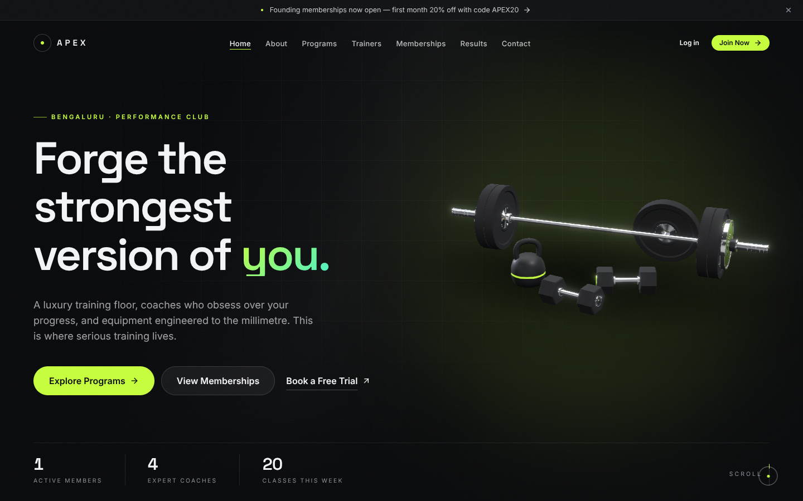

# Apex Athletics — luxury 3D gym website & gym management system

A full-stack platform for a premium fitness club: a cinematic 3D public website that the owner edits from an
admin dashboard (no code changes), plus memberships, Razorpay payments, class/PT bookings, QR attendance,
member and trainer dashboards, notifications and reports.



## What's inside

| Area | Highlights |
| --- | --- |
| **Public website** | Sticky transparent→solid header, announcement bar, 24 CMS section types (hero, stats, programs, 3D equipment, trainers, pricing, schedule, transformations, testimonials, before/after, facilities, BMI & calorie calculator, promo countdown, blog, FAQ, location, trial form, contact, newsletter…), SEO tags, JSON-LD, sitemap, robots |
| **3D layer** | React Three Fiber; procedural, textured PBR models (hex dumbbell, barbell, bumper plate, kettlebell, bench, hero composition); studio lighting without HDR downloads; device quality tiers; lazy-loaded chunks; pauses off-screen; reduced-motion support; static poster fallback without WebGL; approved `.glb` uploads |
| **CMS & theme builder** | Drag-and-drop section builder, field-driven editors, media picker, live device preview, autosave drafts, validated publish, versions & restore; theme presets, colours, fonts, buttons, cards, effects, header/footer with live preview; media library; 3D model review; content collections; blog with Markdown |
| **Admin operations** | Overview KPIs, members, memberships, plans, coupons, payments & refunds, offline payments, trainers, classes (weekly series, rosters), trial requests, front-desk QR check-in, exercise library, reports with CSV, settings, staff permissions, audit log, support, campaigns |
| **Member dashboard** | Membership & renewal/upgrade, checkout, receipts, class & PT booking with waitlist, workouts & logs, progress charts, private progress photos, goals, QR check-in, rewards & referrals, support, notifications |
| **Trainer dashboard** | Assigned members, progress, plan builder, schedule & attendance marking, notes & follow-ups, availability, check-in |
| **Backend** | Express + TypeScript + MongoDB; cookie auth with rotating refresh tokens & CSRF; RBAC + ownership checks; server-priced, signature-verified, idempotent payments; transactions; scheduled jobs with locks; OpenAPI docs |

## Quick start

```bash
docker compose up -d mongo              # MongoDB replica set (or use Atlas)
npm install
cp server/.env.example server/.env      # set JWT_ACCESS_SECRET; PAYMENT_PROVIDER=sandbox for local testing
npm run seed                            # starter website content
npm run create-admin                    # first admin — no default credentials
npm run dev                             # site http://localhost:5173 · API http://localhost:4000/api/docs
```

Full instructions: [docs/setup.md](docs/setup.md).

## Checks

```bash
npm run typecheck && npm run lint && npm test && npm run build
```

Tests: shared schemas (18), server (77, against an in-memory MongoDB replica set), client (28).

## Implemented vs. needs configuration

| Works out of the box | Needs your credentials |
| --- | --- |
| Website, CMS, theme, dashboards, bookings, attendance, reports, local media storage | **Razorpay** keys + webhook secret for real payments ([integrations](docs/integrations.md#razorpay-membership-payments)). Local dev uses a clearly labelled sandbox gateway that goes through the same server verification and is refused in production. |
| In-app notifications | **SMTP** for email (logged until configured) · **WhatsApp** via Meta Cloud API or Twilio (optional) |
| Procedural 3D models | Licensed photogrammetry **.glb** models (optional) — upload in Admin → Website → 3D models ([docs/3d.md](docs/3d.md)) |
| Local uploads | **Cloudinary** (optional) for CDN media storage |

Seeded testimonials/transformation stories are unpublished examples; publish only real, consented member content.
Legal pages (privacy, terms) contain placeholders to replace before launch.

## Documentation

[Setup](docs/setup.md) · [Architecture](docs/architecture.md) · [API](docs/api.md) · [Database](docs/database.md) ·
[CMS](docs/cms.md) · [3D](docs/3d.md) · [Integrations](docs/integrations.md) · [Security](docs/security.md) ·
[Deployment](docs/deployment.md) · [Screenshots](docs/screenshots)
